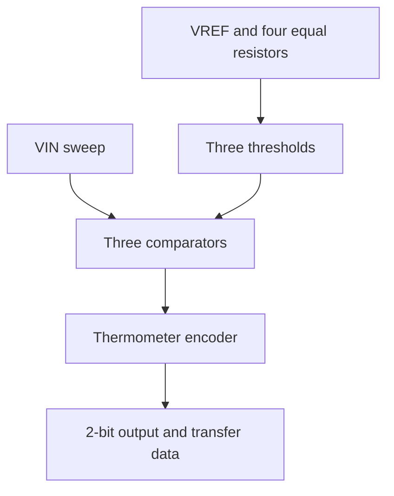
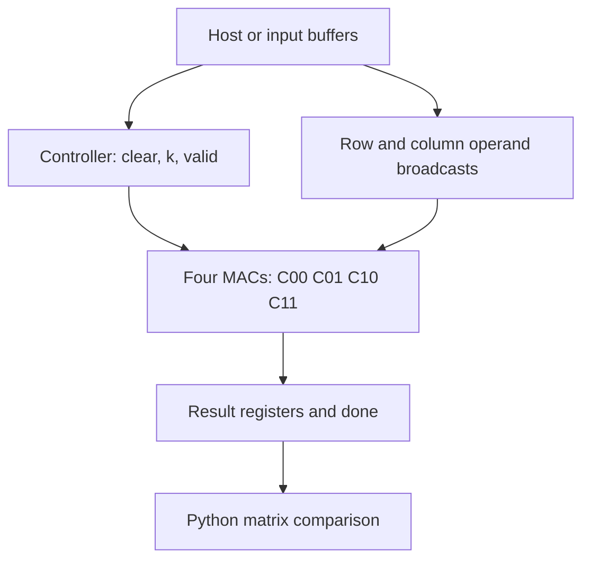

# Operation X — practical engineering project specifications

All projects below are proposals except the ALU/MAC verification explicitly recorded in the audit. Continue existing files rather than making a second starter repository. Read the [resource guide](resource-guide.md) for chapters, legal access, prerequisites and difficulty. “Physical option” is conditional on actual equipment availability; no FPGA board or laboratory inventory has been confirmed.

## One beginner, intermediate and advanced project per repository

| Repository | Beginner project and application | Intermediate project and application | Advanced project and application |
|---|---|---|---|
| **Semiconductor Learning Journey** | Evidence notebook: connect one derivation to a verified ALU or NMOS experiment. Application: reproducible engineering lab notebook. | Cross-layer CMOS inverter study: device I–V → transfer curve → delay/energy versus load. Application: explain standard-cell design tradeoffs. | Reproducible sensor-to-compute case study linking device/converter constraints to integer processing. Application: embedded condition monitoring or sensor inference. |
| **MOSFET Characterization** | Existing NMOS output/transfer curves with Vth and gm extraction. Application: choose a transistor bias point. | Compare a documented discrete NMOS SPICE model against low-current bench measurements; study temperature in simulation. Application: model validation for a sensor amplifier/switch. | DEVSIM diode → MOSCAP → 2D MOSFET with mesh/convergence study and parameter sensitivity. Application: device research and electrostatic design. |
| **8-bit ALU** | Existing seven-function ALU with flags and exhaustive binary-input checks. Application: arithmetic/control datapath; simulation baseline now verified. | Registered request/result wrapper, optional FPGA UART interface and constrained synthesis. Application: reusable synchronous arithmetic block. | Small 8-bit instruction-driven processor with register file, control and memory, using this ALU. Application: a programmable embedded controller teaching model. |
| **CMOS ADC Design** | Planned 2-bit flash ADC and transfer-curve validation. Application: coarse voltage-level classification. | Nonideal comparator-based flash ADC, optional breadboard, and the existing 4-bit R-2R DAC exercise. Application: converter interface/error-budget design. | Transistor-level CMOS comparator and 2-bit flash front end with PVT analysis, then layout/extraction if supported. Application: mixed-signal front-end research. |
| **Tiny AI Accelerator** | Existing signed 8×8 MAC with 24-bit wrap and Python oracle. Application: dot products and FIR-like arithmetic; simulation baseline verified. | Four-PE 2×2 matrix engine with explicit schedule and bit-exact reference. Application: dense-layer computation. | Tiled matrix engine plus a small quantized neural-network workload, with precision and memory-traffic tradeoffs. Application: low-power edge inference on sensor features. |

## Shared engineering standard and evidence labels

Every tier must record the following ten items in its report. Reuse the existing report templates and add missing fields rather than replacing finished work.

1. **Problem and motivation:** one engineering question and the use case it serves.
2. **Theory:** equations, assumptions and cited textbook sections.
3. **Prerequisites:** skills the learner can demonstrate before the experiment.
4. **Setup:** software versions, components, models, instrument ranges and licenses.
5. **Architecture:** original circuit file or RTL/block diagram with interfaces.
6. **Implementation:** numbered steps and exact reproducible commands.
7. **Simulation:** stimulus, oracle, seed, tolerance, corners and termination conditions.
8. **Physical option:** wiring/board revision, conditions and measurement procedure, or a clear simulation-only boundary.
9. **Verification:** predicted versus observed values, pass criteria, failures and coverage gaps.
10. **Communication:** source commit, raw data, figures with units, technical report, README status and a short LinkedIn draft linking the evidence.

Use these labels at the figure/table level:

| Label | What it means | Required provenance |
|---|---|---|
| Analytical prediction | Equation or ideal numerical model | Equation, assumptions, parameters and code |
| Circuit simulation | SPICE circuit/model result | Netlist/schematic, model revision, solver/sweep, units |
| RTL simulation | Digital behavioral result | RTL/testbench versions, simulator, stimulus and comparison |
| TCAD simulation | Numerical device-equation result | Geometry, mesh, material/doping, boundary conditions, solver and convergence |
| Synthesis/implementation estimate | Tool result for a stated flow/target | Tool/PDK/library/part, constraints, stage and assumptions |
| Physical measurement | Actual instrument/board observation | Part/sample/board ID, wiring, instrument, range, conditions and uncertainty |

Do not mix these labels. A simulated thermometer code is not a physical measurement; a generic cell count is not chip area. Passing tests written during an assisted audit is useful evidence, while independent explanation and reproduction demonstrate the learner's competence.

## A. Semiconductor Learning Journey

**Engineering goal.** Build a navigable knowledge base in which every claim links to a derivation, test or measurement. Its real-world role is the traceability needed to reproduce someone else's engineering result.

**Theory and prerequisites.** Use Harris for binary arithmetic/architecture, Hu for devices and Weste for circuits/layout. Practice dimensional analysis, plots with units, basic Python and Git. Start with a derivation you can explain on one page.

**Tools and architecture.** Markdown, Git, Python and the existing seven topic folders. The architecture is: topic note → prediction → linked project experiment → data/report → learning-log entry. Keep raw experiment files in their dedicated repositories; Journey indexes them instead of duplicating them.

**Beginner implementation.** (1) Read the current ALU/MAC audit. (2) Choose `7F+01` and `FF+01` to distinguish signed overflow from carry. (3) Write your own arithmetic prediction and explain how the flags follow. (4) Re-run the existing regression and annotate one actual waveform. (5) Add a dated learning-log entry linking the exact report/commit. (6) For the NMOS project, repeat the same method with a saturation-current prediction. Acceptance: another person can locate the source, command, expected result and actual observation from the note, with no missing parameter or broken link.

**Intermediate inverter project.** Add a new experiment only after the NMOS curves: select compatible NMOS/PMOS models, choose VDD within their documented range, sweep input DC and run pulse/load-capacitance sweeps. Explain VIL/VIH from slope criteria, noise margins, propagation delay and energy drawn from the supply. Compare several Wp/Wn ratios and loads while changing one variable at a time. Acceptance: save the original model/setup and numerical DC/transient data; show why improved switching symmetry can change load and energy. A 5 V discrete CMOS inverter demonstration is optional and must be modeled as its own circuit, not described as the same IC process.

**Advanced integration project.** Define a sensor-to-compute interface: signal range, sample rate, code format, scaling and processing workload. Link the converter study and matrix engine, simulate known stimuli, and check the complete integer signal path. Use a more suitable real ADC for a real sensor if the four-code demonstration is insufficient. Acceptance: trace one input through analog assumptions, conversion, integer processing and reported output; separate conversion error, quantization error and hardware-computation error.

**Physical comparison and communication.** Link physical runs from the dedicated repositories when available, retaining sample/instrument IDs and units. Publish a short technical index and one project explanation, not a list of course titles. Suggested LinkedIn angle: “How a prediction, an automated check and a physical measurement answer different engineering questions.” Do not mark textbook competence complete solely because an assistant created a report.

## B. MOSFET Characterization

**Problem and motivation.** Determine how a transistor's drain current responds to bias and how accurately a selected model predicts it. This supports bias-point selection and the analog comparator work.

**Foundations and prerequisites.** Hu Ch. 5–6; Weste Ch. 2/8; later Tsividis. Know KCL/KVL, voltage/current sign, derivatives and the difference between a parameter named VTO and a measured threshold defined by a test method.

**Existing assets.** Reuse `simulations/nmos-output-educational.cir` and experiments 01/02. The deck uses W/L=10, KP=100 µA/V², VTO=1 V, lambda=0.02 V⁻¹ and source/body at ground. It is an illustrative Level-1 model, not a foundry process or a discrete-device calibration.

**Simulation setup and circuit.** LTspice or ngspice plus Python for CSV plots. Circuit connections: VDS source from drain to ground, VGS source from gate to ground, NMOS source/body to ground. The existing sweep is VDS 0–5 V in 0.1 V steps and VGS 1–4 V in 1 V steps. Save the model and actual simulator temperature. The current deck plots interactively; add a reproducible batch export before calling the data pipeline complete.

**Beginner implementation and methodology.**

1. Compute beta=KP×W/L=1 mA/V² and predict cutoff/triode/saturation boundaries.
2. Run the existing output deck, record software version and capture actual numerical outputs. Use ID=-I(VDS) for the stated source direction.
3. Add a transfer sweep at fixed VDS=3 V, with sufficiently fine VGS steps. The portion above VGS=4 V is not in long-channel saturation, so do not fit the square-law saturation expression there.
4. Compare the piecewise equations with the selected model. In saturation, the educational expression is ID≈0.5×beta×(VGS−VTO)²×(1+lambda×VDS). At VGS=2 V, VDS=3 V, it predicts 0.53 mA. This number is a prediction, not a recorded SPICE run.
5. Extract Vth from a documented square-root-current fit within an appropriate saturation region; report fit window and residuals. Separately demonstrate a constant-current definition if desired. Do not identify the first nonzero sample as a universal Vth.
6. Calculate gm numerically at fixed VDS; compare with beta×(VGS−VTO)×(1+lambda×VDS) in the same idealized regime. Repeat with half the VGS step to check derivative sensitivity.
7. Sweep one model parameter at a time. A temperature study must record the model's actual temperature coefficients; do not extrapolate ideal-model trends to a real process without support.

**Expected results and verification.** Drain current should increase with gate overdrive; the saturation boundary follows VDS≈VGS−VTO in this model; lambda produces output slope. Choose numerical comparison tolerances before inspecting results, e.g. <1% away from cutoff/boundaries for this educational model and matching assumptions. If the criterion fails, investigate model temperature, current direction, body bias and equation assumptions. Never force the data to match the prediction.

**Intermediate physical option.** Use a known-vendor **2N7000** or another documented small NMOS with a suitable model. Required equipment: adjustable current-limited 0–5 V supply, measured 1 kΩ drain resistor, adjustable gate voltage, 1 kΩ gate series resistor, 100 kΩ gate-to-source resistor, breadboard and DMM (two DMMs help). Verify the purchased part's pinout from its own datasheet.

| Connection | Purpose |
|---|---|
| Supply 0–5 V → 1 kΩ RD → drain | Limit drain current to at most about 5 mA from this supply |
| Source → common ground | Define VGS and VDS directly |
| Adjustable 0–5 V gate source → 1 kΩ → gate | Control gate bias |
| Gate → 100 kΩ → source | Avoid a floating gate |
| Measure supply, drain and gate voltages | ID=(Vsupply−VD)/RD; VDS=VD; VGS=VG |

Set a low current limit, keep all voltages inside the exact part ratings and start from zero gate voltage. Sweep actual terminal voltages, not just supply settings. RD limits the reachable VDS/current combinations; document this load-line constraint. If fixed VDS cannot be maintained within the supply/current limits, record the achieved point or narrow the sweep. Do not silently treat it as fixed VDS. Temperature experiments are simulation-first; a physical temperature sweep requires controlled equipment and measured device temperature.

Compare the **same measured resistor, terminal voltages and discrete-device model** in SPICE. Plot measured versus simulated ID, report absolute/relative residuals and DMM/resistor uncertainty, and keep the model source/license. Compare the educational Level-1 model qualitatively; do not fit a few parameters and call it a calibrated IC technology.

**Advanced TCAD implementation.** Start from DEVSIM's capacitor and 1D diode examples. Write the Poisson and carrier-continuity problem, contacts and material/doping values. Validate equilibrium and bias behavior, refine the mesh at least twice and compare integrated/current results. Then progress through MOSCAP to a 2D MOSFET, using small bias increments and recorded solver residuals. Acceptance: demonstrate current conservation, mesh convergence and sensitivity to doping/oxide dimensions. Agreement with a compact model is a comparison, not automatic validation against silicon. Research application: quantify how one electrostatic change affects threshold or leakage.

**Report and portfolio.** Include netlist/model, raw simulated/measured CSV, ID–VDS, ID–VGS, gm, extraction method and uncertainty. LinkedIn angle: one observed difference between a simple prediction and a documented device model, with the source of every curve labeled.

## C. 8-bit ALU in Verilog

**Problem and motivation.** Implement a trustworthy arithmetic block for a future controller or processor. Keep carry/no-borrow and signed overflow separate.

**Foundations and prerequisites.** Harris Ch. 1/2/4/5; Weste Ch. 11/15 later. Know two's-complement, Boolean expressions, combinational always blocks, assignment widths and a self-checking testbench.

**Setup and architecture.** Existing `rtl/alu.v`: a,b → arithmetic/logic/shift paths → opcode selection → y and zero/carry/overflow. Seven functions occupy opcodes 000–110; 111 returns y=0 and zero=1. Tools: Icarus, GTKWave, Python if extending the oracle, Yosys, Git. FPGA hardware is optional.

**Beginner execution and verification.** Reuse the original RTL and starter bench. Run `bash scripts/run_verification.sh`; it checks all 524,288 binary-input combinations and all outputs. Read the dated report and inspect a waveform. Predict unsigned wrap and signed overflow independently. Current audit acceptance is satisfied for binary-input simulation; unknown states and physical propagation delay remain outside scope. Do not rebuild the ALU to claim a second completed project.

**Intermediate implementation.** (1) Specify registered inputs/outputs and exact valid/latency behavior. (2) Wrap the existing ALU without changing its combinational contract. (3) Test reset, consecutive requests, idle cycles and result alignment. (4) Run synthesis for a named target and add clock/input/output constraints. (5) Compare mapped resources and timing against the combinational baseline under equivalent boundaries. Acceptance: bit-exact outputs, correct latency on every transaction, no inferred latches and no unconstrained relevant timing paths.

**Physical option.** Use an available FPGA board supported by its vendor or an open flow, after confirming the exact part and pin/voltage constraints. Start with switches/LEDs for a few cases, then use a USB-UART host test to drive many vectors. Synchronize asynchronous inputs and debounce buttons; use the board clock and clock-enable rather than a button as a clock. Return result/flags to the host and compare against the same oracle. Report board, tool, bitstream, clock constraint and measured mismatches. FPGA resource counts and timing estimates do not establish ASIC area.

**Advanced processor.** Specify a small 8-bit ISA, register file, program/data memory and FSM. Add instructions in steps (load immediate, arithmetic, memory, branch), with a Python instruction-set model and directed short programs. Then verify random bounded programs and branch/reset behavior. Keep the ISA explicitly educational; Harris 2e's MIPS chapters supply concepts, not a ready 8-bit encoding. Acceptance: register/memory traces match the software model, with a documented cycle count. Optional FPGA demo: a simple programmable counter/controller.

**Report and portfolio.** Link opcode/flag specification, source, test counts, representative waveform and mapped results when available. LinkedIn angle: demonstrate why `0x7F+1` and `0xFF+1` have different flag meanings; report actual verification coverage and its limits.

## D. CMOS ADC Design

**Problem and motivation.** Convert an input voltage into one of four codes and quantify transition errors. This models a coarse level detector and introduces mixed-signal interfaces.

**Foundations and prerequisites.** Kester Ch. 2/3/5; Hu MOS sections; Razavi 2–7/14 later. Know voltage dividers, comparator polarity, logic levels, quantization and numerical plotting.

**Beginner setup and architecture.** Preserve the existing VREF=4 V convention: thresholds 1, 2, 3 V, LSB=1 V and ideal code=floor(VIN/LSB), clamped to 0…3. Use LTspice and the existing `scripts/ideal_flash_adc.py`; the Python mapping is an analytical oracle, not SPICE evidence. Build the actual circuit file in `circuits/`.

Use four equal series resistors between VREF and ground; feed VIN to each comparator's non-inverting input and the corresponding threshold to its inverting input. With C3/C2/C1 ordered from highest to lowest threshold, valid codes are 000,001,011,111. For these valid patterns, B1=C2 and B0=C3 OR (C1 AND NOT C2). A real implementation must address or flag invalid thermometer patterns; this expression alone is not a general bubble-error correction scheme.

**Implementation and simulation methodology.** (1) Calculate the resistor taps. (2) Build behavioral comparator and encoder models with documented logic levels. (3) Sweep 0–4 V and refine around each threshold. (4) Export VIN, comparator bits and binary code. (5) Compare with the Python model away from exact switching equality. (6) Add finite gain/delay/offset and resistor tolerance as separate experiments. (7) Apply a slow ramp in both directions to detect hysteresis. Acceptance for the ideal model: no missing codes, correct ordering and threshold error within one sweep step; define the step before running. A transient comparator bank without a sampling latch is asynchronous, not a complete clocked ADC.

**Error definitions.** Let measured transitions be T1,T2,T3, with chosen endpoints T0=0,T4=VREF. For this demonstrator, Wi=T(i+1)−Ti and DNL_i=Wi/LSB−1; internal INL_i=(Ti−i×LSB)/LSB. State that this is the chosen nominal-reference convention, without best-fit gain/offset removal. Compare like conventions. Out-of-range saturation is not a missing code. Exact-threshold Python equality is a convention; a noisy physical comparator has a transition interval.

**Intermediate physical option.** A through-hole LM339-family quad comparator is a possible starting part, using the exact variant's datasheet. To keep both inputs comfortably inside the common-mode range on a 5 V supply, use a **separate hardware configuration with VREF=2 V and VIN=0–2 V**, giving thresholds 0.5, 1, 1.5 V. Simulate this same variant before comparison. The existing 4 V ideal experiment remains intact. With the current Python code, `quantize_ideal` accepts `vref=2`, but `thermometer_bits` is hardcoded to 1/2/3 V; parameterize or add a distinct hardware oracle before reusing that function.

Equipment/components: 5 V current-limited supply, measured 2 V reference, four matched/measured 10 kΩ ladder resistors, three 10 kΩ output pull-ups, 100 nF decoupling at each IC, comparator, suitable 5 V logic encoder ICs (or read the thermometer bits initially), input potentiometer, DMM and optional oscilloscope/logic analyzer. Open-collector outputs need pull-ups; unused comparator/logic inputs must not float. Check loading and logic compatibility. Connect all grounds deliberately and stay with low-voltage bench supplies.

Measure the three transitions for increasing and decreasing VIN, record actual VREF/resistor values and compare with a SPICE model containing those values. Set a preliminary hardware target, for example transition error ≤0.1 LSB, then report whether it was achieved and why. Avoid claiming sample rate from a slow DC test. The existing R-2R project can supply a controlled staircase stimulus after all 16 DAC codes are verified; its own error must be included in the ADC test uncertainty.

**Advanced CMOS comparator.** Use a documented PDK/model set and its valid supply range (not automatically the educational 5 V setup). Begin with a biased differential pair and current mirror; verify operating regions before adding regenerative or clocked behavior. Characterize input common-mode range, minimum resolvable differential input, offset, propagation/decision delay, power and kickback. Sweep process/voltage/temperature; run mismatch statistics only if the models support them, otherwise label injected offsets as an assumed sensitivity study. Add layout, DRC/LVS and parasitic extraction later. Compare pre/post-layout behavior. This is simulation/layout research until actual silicon is fabricated and measured; a breadboard LM339 is a separate architectural demonstrator, not validation of the integrated transistor layout.

**Report and portfolio.** Include original schematic, model licenses, transfer data, transition uncertainties, DNL/INL convention and failure cases. LinkedIn angle: show how one resistor or comparator offset changes the code widths, without presenting synthetic curves as laboratory results.

## E. Tiny AI Accelerator

**Problem and motivation.** Compute integer dot products with predictable precision and a schedule that exposes data reuse. This is a foundation for neural-network inference and signal-processing kernels.

**Foundations and prerequisites.** Harris Ch. 3–5 then 6–8; Weste Ch. 11/12; Sze metrics, kernels, mapping and precision sections. Know signed integer limits, registers/FSMs, matrix multiplication and memory versus computation cost.

**Beginner setup and architecture.** Preserve the existing MAC: signed A8×B8 → signed product16 → sign extension → sum with ACC24 → enabled resettable accumulator. Asynchronous active-low reset dominates synchronous clear, which dominates enable. Overflow wraps; it does not saturate. Icarus, GTKWave, Python and Yosys are sufficient without a board.

**Beginner verification.** Run `bash scripts/run_verification.sh`. The dated audit covers all signed operand pairs from cleared state, directed wraps/control tests and deterministic random sequences against Python. Explain why 512 products of (-128)×(-128) wrap the 24-bit result. This is numerical hardware correctness, not neural-network model accuracy. The unmodified MAC and Python reference are already verified within the report's stated coverage.

**Intermediate 2×2 architecture.** Start with a straightforward **output-stationary broadcast array**: four existing MACs hold C00,C01,C10,C11; broadcast row operands Aik and column operands Bkj at each k. This is a processing-element array; do not call it a systolic array unless neighbor forwarding and staggered timing are actually implemented.

**Implementation sequence.**

1. Specify the transaction boundary, input storage, reset/clear, valid/done and whether stalls are supported. Initially allow one matrix transaction at a time and no mid-compute stalls; later extensions must define them explicitly.
2. At a documented clear edge set all accumulators to zero. On the next two enabled edges supply k=0 and k=1. Observe the four results after the second compute edge. Clearing and accumulating cannot occur on the same edge with the existing MAC contract.
3. Build the controller and broadcasts, then compare Cij=sum_k Aik×Bkj against Python integers widened before multiplication and explicitly wrapped to 24 bits.
4. Test zeros, identity, mixed signs, extrema, matrix boundaries, reset during computation and repeated transactions. Add fixed-seed random matrices. Test any stall protocol only after implementing it.
5. Retain raw transaction/cycle data and synthesize. For larger matrices, add input buffers and tiling only after the 2×2 result passes.

**Expected results and verification.** The 2×2 product needs eight MAC updates, four per compute edge. A sum of two maximal positive signed-int8 products is +32768, so a signed 16-bit sum is insufficient; the existing 24-bit accumulators are ample. Require exact equality to the integer oracle, not an approximate neural-network tolerance. Record compute edges separately from clearing, loading and draining. Report total latency from input acceptance to valid output, initiation interval and achieved MACs/total cycles. Peak four MACs/compute cycle is an architectural rate; it is not measured frequency or end-to-end throughput. If counting arithmetic operations, state explicitly whether one MAC counts as two operations.

**Advanced application.** Tile a larger matrix or small dense layer over the 2×2 engine. Choose a public, licensed dataset or clearly labeled synthetic sensor features; freeze weights, train/test split, scales, rounding and clipping. First match a bit-accurate integer Python model exactly, then compare that quantized model's task accuracy with a floating-point baseline. Study one variable (accumulator width, operand precision, data reuse or sparsity) at a time. Measure input/output traffic as well as compute cycles. A motor-monitoring application needs real representative sensor data before making diagnostic-performance claims.

**Physical option and comparison.** Once a compatible FPGA is available, load vectors over UART or another documented interface, capture results/cycle counts and compare with the exact same host oracle. Report LUT/FF/DSP/BRAM mapping, timing constraints and board/bitstream versions. Power comparison requires a repeatable workload and an actual measurement boundary: idle versus active board power is not isolated ASIC-core power. Without hardware, deliver deterministic RTL simulation, a named-target synthesis report when possible, and explicitly labeled estimates; FPGA deployment is optional.

**Report and portfolio.** Include architecture/interface timing, numerical format, stimulus seed, result hashes, verification coverage and latency/resource tables. LinkedIn angle: explain why a correct MAC is only one component of an accelerator and show the verified dataflow/memory tradeoff when the array exists.

## Compact report and presentation workflow

For each milestone, write a 2–5 page-equivalent Markdown report: problem/specification, prediction, setup, method, actual data, discrepancy analysis and limitations. Include one clear architecture/circuit figure, one result plot/table and the exact reproduction command. Add a short README status line pointing to it and one learning-log entry. A concise LinkedIn draft should state the question, one actual result, one limitation, one lesson and a link. Keep personal drafts private; publish only when you choose to share them.
