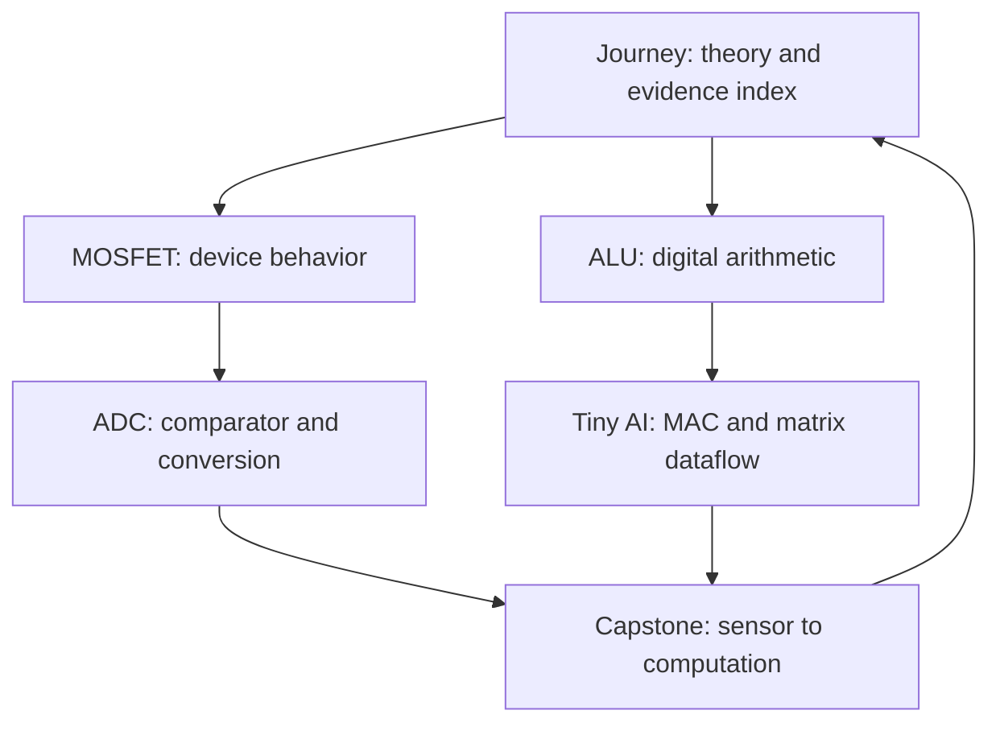

# Operation X — prioritized engineering roadmap

Updated 18 November 2026. Continue the existing five repositories; preserve the original code and experiment plans. The two RTL blocks now have executed evidence. Most analog, physical and research milestones remain planned.

## What is verified today

| Repository | Evidence established | Still open |
|---|---|---|
| semiconductor-learning-journey | Existing seven-topic structure, roadmap, log and templates reviewed | Learner-written derivations, solved exercises and independent reproduction |
| mosfet-characterization | Existing Level-1 netlist and two protocols inspected | SPICE execution, CSV/plots, Vth/gm extraction and measurements |
| 8bit-alu-verilog | 14 starter checks; 524,288 exhaustive vectors; generic Yosys synthesis | GUI waveform review, registered interface, target mapping, timing and FPGA |
| cmos-adc-design | Architecture, ideal Python mapping and flash/R-2R plans inspected | Actual comparator/ladder circuit, SPICE data and hardware |
| tiny-ai-accelerator | 4 Python tests; 7 starter MAC checks plus reset; 142,123 reference cycles; generic synthesis | PE protocol, 2×2 array, numerical ML evaluation and FPGA |

See [audit and source revisions](docs/operation-x-review-2026-11-18.md), [15 project levels and engineering specifications](docs/engineering-projects.md), and [resource guide](docs/resource-guide.md). A passing assisted audit establishes source behavior in those tests; it does not automatically mark the learner's understanding complete.

## Priority order and exit gates

Using 6–8 hours/week solely as a project-planning assumption, The following 12–18+ month horizon is adjustable and builds a credible undergraduate portfolio; professional expertise also requires deeper coursework, collaboration, reviews and sustained project experience. Advance by evidence rather than dates.

| Priority / indicative effort | Work | Exit evidence |
|---|---|---|
| P0 — this audit | Verify existing ALU and MAC before extending them | Completed for the documented binary-input simulations and generic synthesis; limitations recorded |
| P1 — next 1–2 weeks, 6–12 h | Reproduce both regressions locally; study flags, widths, reset and clocked updates | Your own run logs; annotate one waveform; explain `7F+01`, `FF+01`, `03-09` and MAC wrap |
| P2 — weeks 3–6, 18–24 h | Run existing NMOS output deck; add transfer sweep and Python extraction | Labeled I–V CSV/plots, threshold method, gm, quantitative comparison to the model |
| P3 — weeks 7–10, 18–24 h | Build the planned 2-bit flash ADC, then use the R-2R project as a supporting exercise | Original circuit, 3 measured simulation thresholds, full transfer table, static errors and limitations |
| P4 — weeks 11–16, 30–40 h | Learn sequential RTL and FSMs; add registered ALU interface; implement the 2×2 matrix array | Cycle contract, bit-exact Python comparison, back-to-back/control tests, latency and operand-traffic counts |
| P5 — months 5–7, 40–60 h | Differential pair/current mirror/comparator; practical device or ADC measurement if equipment exists | Bias/DC/transient reports, nonideal sweeps, and clearly separated physical results if collected |
| P6 — months 8–10, 45–70 h | DEVSIM capacitor/diode, MOS electrostatics and mesh convergence; small CPU or memory study | Boundary-condition explanation, convergence evidence; processor tests with documented ISA if pursued |
| P7 — months 11–13, 45–70 h | Map a verified registered digital block to a named FPGA or open standard-cell flow | Pinned tool/PDK, timing constraints, mapped resources, layout/STA and DRC/LVS where applicable |
| P8 — months 14–18+, 50–90 h | Select one research-oriented capstone: device modeling, mixed-signal design, or quantized AI hardware | Reproducible baseline, one measured/simulated design tradeoff, reviewable report and a restrained portfolio presentation |

Do not run all advanced tracks at once. Keep **one main experiment and one light reading track** active. A useful 7-hour week is 2 h reading/derivation, 3 h implementation/testing, 1 h analysis and 1 h documentation. During academic exams, reduce project work rather than accumulate unverified milestones.

## How the repositories connect

The capstone can relate to motor monitoring: characterize a low-voltage sensor interface, document conversion limits and process a feature vector with the matrix block. The 2-bit flash ADC is a teaching demonstrator; a real diagnostic system will probably need a suitable higher-resolution ADC. Do not imply that four quantization codes establish useful fault-classification accuracy.

## The next four working sessions

1. **Digital evidence, 90 min:** run `bash scripts/run_verification.sh` in ALU and AI; inspect the actual VCD in GTKWave; predict arithmetic before checking results. Keep output in a new dated folder rather than replacing the audit logs.
2. **Device prediction, 90 min:** read Hu's MOS capacitor/transistor sections; for the existing Level-1 deck calculate beta, the saturation boundary and one current point. At VGS=2 V and VDS=3 V the simplified model predicts about 0.53 mA including its lambda term; this is an analytical prediction, not a measured result.
3. **Device simulation, 2 h:** run the existing netlist in LTspice/ngspice, retain it, add batch CSV export, and compare against the prediction. Check `ID=-I(VDS)` and sweep/model units.
4. **Report, 2 h:** write the first device report, explain any discrepancy and link files from the learning log. Then plan a transfer sweep; do not begin TCAD until the compact-model result can be explained.

## Original learning goals retained

These are learner competence goals and remain open unless demonstrated personally.

- [ ] Explain intrinsic/extrinsic carriers, doping and junction bias.
- [ ] Analyze MOSFET regions, threshold voltage and model limits.
- [ ] Simulate and explain a CMOS inverter.
- [ ] Design and verify an R-2R DAC and flash ADC.
- [ ] Explain and modify combinational/sequential Verilog independently.
- [x] Establish repeatable ALU/MAC artifact-level simulation evidence (2026-11-18 audit).
- [ ] Understand timing, power, area and constraints with a named target.
- [ ] Demonstrate TCAD boundary conditions and mesh convergence.
- [ ] Complete a device, converter and AI-computation report with reproducible evidence.
- [ ] Deliver a focused capstone and explain its limitations in a technical review.

## Professional practices introduced progressively

Start now with an explicit specification, versioned inputs, source hashes, units, nonzero test failure exits, deterministic seeds and short reports. Next add automated CI, code review, requirements-to-tests mapping and linting. Add assertions/formal properties when the interface becomes stateful. Introduce clock/reset constraints, clock-domain review, PVT corners, DRC/LVS and extracted simulation only when a target and physical design exist. Use one simple practice well before adding a heavier methodology such as UVM.
